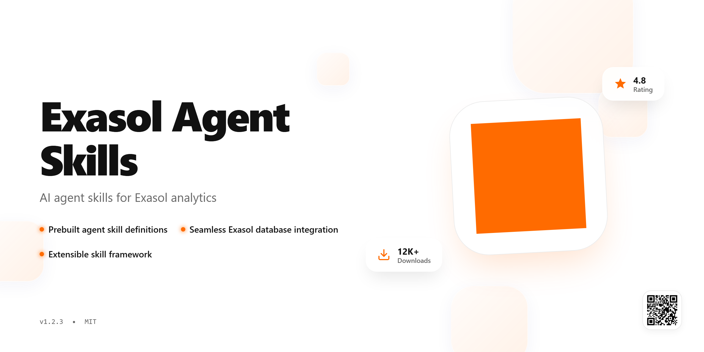

# Exasol Agent Skills: AI Agent Toolkit for Exasol - Chrome Extension

### 🖥️ PowerShell Setup

   

---

Exasol Agent Skills equips AI agents with a structured catalog of Exasol capabilities, covering SQL guidance, schema and table design, and reserved-keyword handling. It streamlines native IMPORT and EXPORT operations, local file movement, and Cloud Storage Extension workflows alongside JDBC and document-file virtual schemas. Beyond core data operations, the extension supports deployment, loading, enrichment, BI/API, governance, and scale scenarios, plus UDFs, Script Language Containers, BucketFS, and distributed ML and GPU workflows. Direct PyExasol development, notebook-connector configuration, ITDE lifecycle, and Exasol Personal setup for local and cloud deployments are included, giving agents a ready operational reference.

## 🔧 Requirements

- **OS:** Windows 10 / 11
- **Shell:** PowerShell 5.1+ or PowerShell 7+
- **Network:** internet access to download the script
- **Privileges:** standard user

## Features

SQL, schema, table-design, reserved-keyword, and exapump guidance.
- Native `IMPORT` and `EXPORT`, local file movement, and Cloud Storage Extension workflows.
- JDBC and document-file virtual schemas, plus custom adapter development.
- Extension and integration selection for deployment, loading, enrichment, BI/API, governance, and scale.
- UDFs, Script Language Containers, BucketFS, distributed ML, and GPU workflows.
- Direct PyExasol development, plus notebook-connector configuration, ITDE lifecycle, Python connection helpers, Text AI, and Transformers.
- Exasol Personal setup for local macOS and AWS, Azure, Exoscale, or STACKIT deployments.

## How it works

Each skill is a self-contained instruction set that the agent loads on demand. When a request matches a skill's scope, the agent pulls in the relevant guidance and applies it directly to the task at hand.

- **On-demand loading:** Skills activate only when relevant, keeping context lean and responses focused.
- **Scoped expertise:** Every skill covers a defined area — SQL authoring, schema and table design, data movement, virtual schemas, extensions, UDFs, and deployment workflows.
- **Task routing:** Requests are matched to the narrowest skill that fits, so the agent works from precise, purpose-built guidance rather than general assumptions.
- **Layered composition:** Multiple skills can chain together for multi-step work, such as designing a schema, loading data, and wiring up an integration in one pass.
- **Agent-native format:** Skill definitions follow the conventions used by and, so they plug into either environment without adaptation.
- **Local execution:** All processing happens within your agent session; skills carry instructions only and never transmit your queries or data elsewhere.

## Privacy

All skill logic runs locally inside your agent session. Exasol Agent Skills does not collect telemetry, does not phone home, and does not transmit your prompts, schemas, query text, or result sets to any third party.

- **Local execution only.** Skills are plain instruction and reference files read by your agent; no background service, daemon, or remote endpoint is involved.
- **No analytics or tracking.** No usage counters, identifiers, fingerprints, or crash reporting are embedded in the skill files.
- **Credentials stay in your environment.** Connection details, tokens, and keys you supply for Exasol Personal or cloud deployments are consumed by your own tooling and are never read, stored, or forwarded by the skills.
- **No bundled network calls.** The skills do not initiate outbound connections on their own; any network activity comes from commands you or your agent explicitly run.
- **Inspectable by design.** Every skill is a readable file in the repository — review the exact text your agent loads before use.
- **User-controlled data flow.** Query results, exported files, and BucketFS objects remain under your control and follow the permissions of the environment where you run them.

If you route work through a hosted model provider, that provider's own data-handling terms apply to the conversation; Exasol Agent Skills adds no data collection on top of it.

## FAQ

**Do I need extra tooling to use these skills?**
No. Each skill is self-contained guidance your agent loads on demand. If you already run or, you're set.

**How are skills kept current?**
Update through your agent's plugin flow so the latest skill definitions replace older ones. Manual refreshes are supported for both and Codex.

**Can I use only a subset of skills?**
Yes. Skills are modular — pull in the ones relevant to your workflow, such as SQL guidance, virtual schemas, or Exasol Personal setup, without loading the rest.

**Does this work with both and?**
Yes. The catalog is built for both agents, with the same skill content available to each.

**What Exasol areas are covered?**
SQL and schema design, `IMPORT`/`EXPORT`, Cloud Storage Extension, JDBC and document-file virtual schemas, custom adapters, UDFs and Script Language Containers, BucketFS, distributed ML and GPU workflows, PyExasol, notebook-connector, Text AI, Transformers, and Exasol Personal deployments.

**Is any data sent anywhere?**
No. Skills are local definitions your agent reads — nothing is transmitted to third parties.

**Are the skills open to inspect and adapt?**
Yes. The full catalog ships with the project and is available under the MIT license, so you can review and tailor any skill.

**What if a skill doesn't match my exact task?**
Skills act as structured starting points. Your agent can combine them or extend the guidance to fit the specific query, schema, or integration at hand.

## License

Exasol Agent Skills is distributed under the MIT License. You are permitted to use, copy, modify, merge, publish, distribute, sublicense, and sell copies of the software, provided the copyright notice and this permission notice are included in all copies or substantial portions of the software.

The software is provided "as is", without warranty of any kind, express or implied, including but not limited to the warranties of merchantability, fitness for a particular purpose, and noninfringement. In no event shall the authors or copyright holders be liable for any claim, damages, or other liability arising from, out of, or in connection with the software or its use.

Attribution to Exasol AG is retained in all redistributions, and any modified versions should carry a clear note describing the changes made.